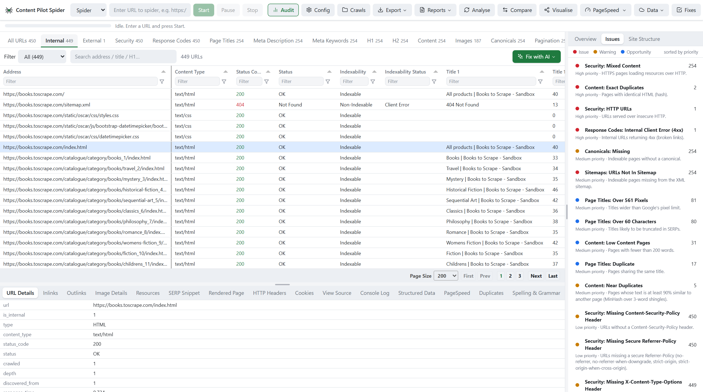
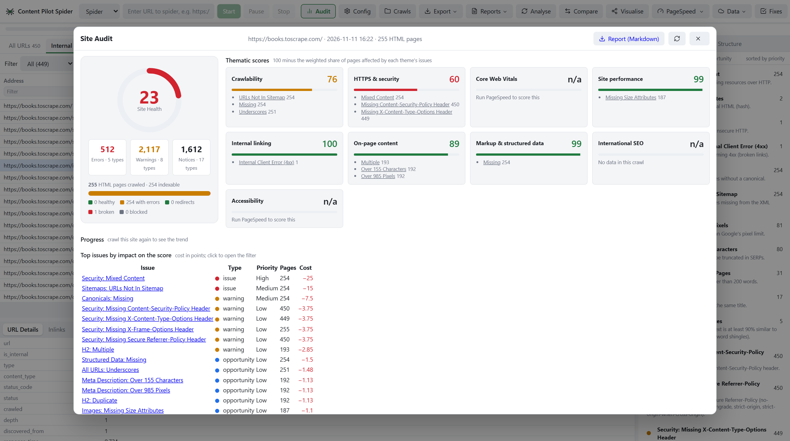
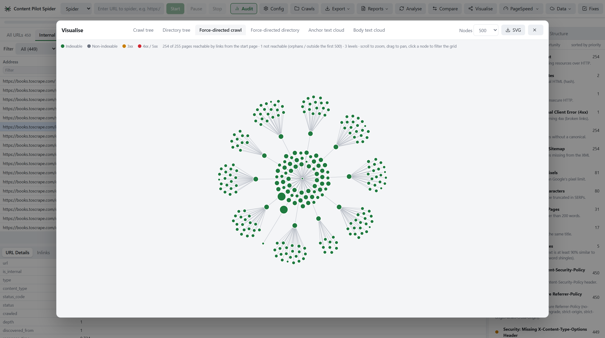

<p align="center">
  
</p>

<h1 align="center">Content Pilot Spider: free, open-source SEO crawler and Screaming Frog alternative</h1>

<p align="center">
  Crawl any website from your own computer, find the technical SEO issues, and fix them.<br>
  No URL limit. No licence fee. Your crawl data never leaves your machine.
</p>

<p align="center">
  
  
  
  
</p>

<p align="center">
  <a href="https://github.com/arunbathiniseo/content-pilot-seo-spider/releases/latest"></a>
</p>

<p align="center">
  <a href="#download-for-windows">Download</a> ·
  <a href="#quick-start-from-source">Run from source</a> ·
  <a href="#what-it-does">What it does</a> ·
  <a href="#how-it-compares">How it compares</a> ·
  <a href="docs/reference.md">Full reference</a>
</p>



## What is Content Pilot Spider?

Content Pilot Spider is a free, open-source website crawler and technical SEO audit tool for Windows, macOS and
Linux. It is a desktop SEO spider in the style of Screaming Frog SEO Spider: it crawls a site the way a search
engine does and reports broken links, redirect chains, duplicate content, missing titles and meta descriptions,
canonical and hreflang errors, and more than 300 other checks, with no limit on the number of URLs.

## Why this exists

Desktop SEO crawlers are the workhorse of technical SEO, but the free tiers stop at a few hundred URLs and the
useful parts (JavaScript rendering, Search Console data, scheduling, custom extraction) sit behind a yearly licence.

Content Pilot Spider is a crawler you can read, change and run without limits:

- **Familiar.** The 29 tabs and more than 300 filters carry the names SEOs already know: Internal, Response Codes, Page
  Titles, Canonicals, Hreflang, Directives and the rest.
- **Local.** One SQLite file per crawl, saved on your disk. Nothing is uploaded anywhere.
- **Unlimited.** Crawl as many URLs as your machine can hold.
- **Goes one step further.** It does not stop at a list of problems: it scores the site, writes the fixes and can
  push approved fixes to WordPress.

## What it does

### Crawl

- **Three modes**: Spider (follow links, discover XML sitemaps through robots.txt), Sitemap (every URL in a sitemap
  or sitemap index) and List (paste URLs).
- **JavaScript rendering** in headless Chromium. Raw and rendered HTML are both kept, so the JavaScript tab shows
  what only exists after rendering: titles, canonicals, links and content changed or added by scripts.
- **Full control**: robots.txt handling, speed and threads, user-agent presets, custom headers, basic auth, include
  and exclude patterns, URL parameter removal.
- **Custom search and custom extraction** with XPath, CSS selectors or regex.

### Find

- **More than 300 filters across 29 tabs**: response codes, redirect chains and loops, titles, meta descriptions,
  headings, canonicals, pagination, directives, hreflang with reciprocity checks, images, security headers, mixed
  content, sitemaps and orphan pages.
- **Duplicates and near duplicates** (MinHash), internal Link Score, inlinks and outlinks for every URL.
- **Structured data** validated offline against schema.org and Google's rich-result requirements.
- **Spelling and grammar** in eight languages, with a dictionary that learns your site's own vocabulary.
- **PageSpeed and accessibility**: Lighthouse and axe-core run locally, or through the PageSpeed Insights API for
  real-user Core Web Vitals.
- **Your own data merged in**: Google Search Console, GA4, Ahrefs, Moz and Majestic, each with your own keys.

### Understand



- **Site Audit dashboard**: one Site Health score out of 100 with its formula shown, nine thematic scores
  (crawlability, HTTPS, Core Web Vitals, internal linking, on-page and more) and the issues ranked by how many
  points each one costs.
- **Compare two crawls**: pages added, removed and changed, and which issues are new or fixed.
- **Visualisations**: crawl tree, directory tree, force-directed diagrams and word clouds, exportable as SVG.



### Fix

- **Fix with AI, with your own key**: Anthropic Claude, OpenAI, Google Gemini, Ollama or any OpenAI-compatible
  endpoint. Titles, meta descriptions, H1s, alt text and redirects for 404s are written for the pages you select.
- **Mechanical fixes need no AI at all**: mixed content, unsafe links, canonical and markup problems are built from
  the crawl evidence, with exact before and after snippets. A problem that repeats on most pages is recognised as
  one template fix, not hundreds of copies.
- **Review, then push**: approve or edit every proposal in a queue, export it, or push it to WordPress or to any
  CMS through a signed webhook. Pushing to a live site asks for confirmation by name.

### Automate

- **Scheduled crawls** (hourly, daily, weekly) with exports, comparisons and an email report when each one ends.
- **Command line** for terminals and CI: `cli.py crawl https://example.com --fail-on-high` fails a pipeline when a
  crawl finds high-priority issues.
- **MCP server**: more than 50 tools, so Claude Desktop, Claude Code or Cursor can start crawls, read issues and
  prepare fixes for you.
- **Exports**: any filter to CSV or XLSX, the whole crawl as one workbook, 18 ready-made reports, and XML sitemap
  generation.

## How it compares

|  | Content Pilot Spider | Screaming Frog SEO Spider (free version) |
|---|---|---|
| Price | Free, MIT licence | Free |
| URL limit per crawl | None | 500 |
| JavaScript rendering | Yes | Paid licence |
| Search Console and GA4 data | Yes | Paid licence |
| Custom search and extraction | Yes | Paid licence |
| Scheduling and command line | Yes | Paid licence |
| Crawl comparison | Yes | Paid licence |
| Site Health score and audit dashboard | Yes | No |
| AI-written fixes, pushed to your CMS | Yes, with your own key | No |
| MCP server for AI assistants | Yes | No |
| Source code | Open | Closed |

Screaming Frog SEO Spider is a mature product with many years of development behind it and a full support team.
Content Pilot Spider is younger: expect rough edges, and please [report what you find](../../issues). Check the
Screaming Frog website for its current free and paid features.

## Download for Windows

1. Download **ContentPilotSpider-Setup-1.0.0.exe** from the
   [latest release](https://github.com/arunbathiniseo/content-pilot-seo-spider/releases/latest) and run it. It
   installs for your user only, so it needs no administrator rights.
2. Open **Content Pilot Spider** from the Start menu, type a URL and press **Start**.
3. For JavaScript rendering, run **Install browser for JavaScript rendering** from the Start menu once. It
   downloads Chromium (about 150 MB).

Nothing else needs installing: Python and everything the app uses are inside the download. A portable zip that
runs without installing is on the same release page.

- The installer is not code-signed yet, so Windows SmartScreen shows "Windows protected your PC" the first time.
  Choose **More info**, then **Run anyway**.
- PageSpeed audits in the installed app use the PageSpeed Insights API with your own free key. Local Lighthouse
  audits need the from-source setup below.
- Your crawls and settings are kept in the installation folder and are left in place if you uninstall.

## Quick start from source

You need **Python 3.10 or newer** and **Node.js 22.19 or newer** (for the grid, the charts and Lighthouse).

**Windows**

```
git clone https://github.com/arunbathiniseo/content-pilot-seo-spider.git
cd content-pilot-seo-spider
python -m venv .venv
.venv\Scripts\python.exe -m pip install -r requirements.txt
.venv\Scripts\python.exe -m playwright install chromium
cd ui\vendor && npm install && cd ..\..
.venv\Scripts\python.exe run.py
```

**macOS and Linux**

```
git clone https://github.com/arunbathiniseo/content-pilot-seo-spider.git
cd content-pilot-seo-spider
python3 -m venv .venv
.venv/bin/python -m pip install -r requirements.txt
.venv/bin/python -m playwright install chromium
(cd ui/vendor && npm install)
.venv/bin/python run.py --browser
```

Then type a URL and press **Start**.

- `run.py` opens the desktop window; `run.py --browser` opens the same interface in your default browser.
- On Windows you can also double-click `Content Pilot Spider.bat` once the steps above are done.
- The Playwright step is only needed for JavaScript rendering and local Lighthouse audits.
- Crawls are saved in `crawls/` and can be reopened from **Crawls**.

The app is developed and tested mainly on Windows 11. On macOS and Linux, `--browser` is the most reliable way to
run it.

## Use it from the command line

```
python cli.py crawl https://example.com --max-urls 500 --export issues --out reports --fail-on-high
python cli.py list
python cli.py schedule add --url https://example.com --frequency daily --time 03:00
```

## Use it from an AI assistant

While the app is open, its MCP endpoint is `http://127.0.0.1:7743/mcp`:

```
claude mcp add --transport http content-pilot-spider http://127.0.0.1:7743/mcp
```

**Config, MCP** in the app shows ready-made snippets for Claude Desktop, Claude Code and Cursor.

## Privacy

- Crawls, settings and API keys stay on your computer. `settings.json` and `crawls/` are ignored by git.
- The desktop app listens on `127.0.0.1` only, answers only requests addressed to this computer, and refuses
  writes that come from another website, so a page open in your browser cannot reach it.
- Text from crawled sites is treated as text everywhere: in the grid, in reports and in CSV and XLSX exports.
- Pages are rendered in a sandboxed headless Chromium.
- AI and third-party data features are off until you add your own key, and they talk only to the provider you chose.

## Documentation

| Document | What is in it |
|---|---|
| [docs/reference.md](docs/reference.md) | Every feature in detail, the HTTP API, hosted mode, scheduling, the MCP server, tests and code layout |
| [docs/screaming-frog-spec.md](docs/screaming-frog-spec.md) | The feature inventory this crawler is built against |
| [docs/oss-survey.md](docs/oss-survey.md) | Why it is built this way, and the open-source crawlers that were surveyed first |
| [docs/tunnel.md](docs/tunnel.md) | Reaching your own Spider from another device through a Cloudflare tunnel |
| [docs/backlog-next-phase.md](docs/backlog-next-phase.md) | What is planned next |

## Built with

Python, FastAPI, httpx and lxml for the crawler; SQLite for storage; Playwright for rendering; Tabulator and D3 for
the interface; pywebview for the desktop window.

## Contributing

Issues and pull requests are welcome. Before you open a pull request, run the test gate:

```
.venv\Scripts\python.exe tests\run_all.py --quick
```

The suites need one saved crawl of a few hundred pages in `crawls/` to test against, so crawl any site once first.
Two house rules for the interface: no emoji or pictographs (use the SVG icons in `ui/icons.js`), and no sample
data (an empty state names the next action instead).

## Frequently asked questions

**Is Content Pilot Spider really free?**
Yes. It is open source under the MIT licence, with no paid tier, no licence key and no URL limit.

**How many URLs can it crawl?**
As many as your computer can hold. Each crawl is one SQLite file on your disk. Very large crawls (50,000 URLs
and more) work, with short pauses in the interface while analysis runs.

**How is it different from Screaming Frog SEO Spider?**
It is free and open source, has no 500-URL cap, adds a Site Health score and audit dashboard, writes fixes with
your own AI key, and can be driven by AI assistants through MCP. Screaming Frog is the more mature product. See
[How it compares](#how-it-compares).

**Does it render JavaScript?**
Yes, in headless Chromium, and it shows what changed between the raw and the rendered HTML.

**Is there a Windows installer?**
Yes. Download the Setup file from the [latest release](https://github.com/arunbathiniseo/content-pilot-seo-spider/releases/latest);
it needs nothing else installed.

**Does it work on macOS and Linux?**
Yes, from source, in your browser with `run.py --browser`. It is developed and tested mainly on Windows 11.

**Does it send my crawl data anywhere?**
No. Crawls, settings and keys stay on your computer. AI and third-party data features only run when you add your
own key, and only talk to the provider you chose.

**Can I use it for client work or inside a company?**
Yes. The MIT licence allows commercial use.

## About

Built by **Arun Bathini**. Content Pilot Spider is the crawler behind
[Content Pilot](https://contentpilot.cloud), the SEO content platform at contentpilot.cloud.

Released under the [MIT licence](LICENSE). Copyright (c) 2026 Arun Bathini, Content Pilot.

Screaming Frog is a trademark of Screaming Frog Ltd. This project is an independent alternative and is not
affiliated with, endorsed by or connected to Screaming Frog Ltd.
